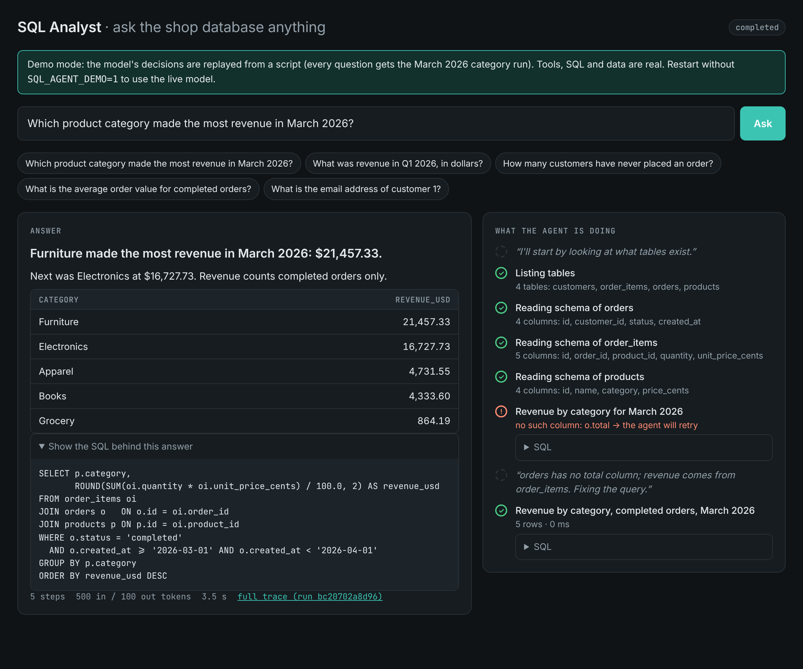

# SQL Analyst Agent

Ask business questions in plain English. The agent explores the schema, writes SQL, fixes its own mistakes, and answers with the query it used. It is read-only, it can't see customer emails, and every run is traced.



## Who it's for

- **People who need numbers but don't write SQL** (founders, ops, product, support leads): type a question, get the answer, the table, and the exact query, so an engineer can check it.
- **Engineers learning to build agents**: a small, readable codebase with no framework. The loop, tools, safety and streaming are each one file you can read in a sitting.
- **Teams evaluating "chat with your database" tools**: a reference for doing it safely (read-only, column-level PII blocking, time limits, audit log, evals).

## What makes it more than a demo

| Concern | How it's handled |
|---|---|
| Safety | Enforced by the database engine, not the prompt: read-only connection, only SELECT allowed, `customers.email` blocked, 3 s timeout, 100-row cap |
| Correctness | Business definitions (what "revenue" means) in the system prompt; an eval suite with reference SQL and code graders |
| Self-correction | SQL errors go back to the model, which fixes its query |
| Observability | Every run stored with each step, tool call, error, token count and duration (`GET /runs/{id}`) |
| UX | Steps stream live to the browser over SSE |
| Testing | 33 tests run with no API key: a scripted fake model drives the real loop |

Built with Python, FastAPI, SQLite, the Anthropic SDK and a hand-written agent loop. No agent framework.

## Run it

```bash
pip install -r requirements.txt
python scripts/seed.py                 # builds data/shop.db (300 customers, 2,500 orders)
python -m pytest -q                    # 33 tests, no API key needed
export ANTHROPIC_API_KEY=sk-ant-...
python -m sql_agent.cli "Which product category made the most revenue in March 2026?" --trace
```

Web UI (live steps over SSE):

```bash
uvicorn sql_agent.api:app --reload        # then open http://localhost:8000
SQL_AGENT_DEMO=1 uvicorn sql_agent.api:app # no key needed: replays a scripted model run on the real DB
```

HTTP API:

```bash
uvicorn sql_agent.api:app --reload
curl -s localhost:8000/ask -H 'content-type: application/json' -d '{"question":"What was revenue in Q1 2026?"}'
curl -s localhost:8000/runs/<run_id>   # full trace: every step, tool call, error and token count
```

Evals (calls the model, costs a little):

```bash
python -m evals.run_evals
python -m evals.run_evals --only aov,q1_revenue
```

## How it fits together

```
POST /ask ─▶ api.py ─▶ agent.py  (the loop)
                         │  model call ─▶ stop_reason?
                         │     tool_use ─▶ tools.py ─▶ db.py (read-only, authorizer, timeout, row cap)
                         │     end_turn ─▶ answer
                         ▼
                      store.py (runs.db: every run + steps for replay/audit)
```

| File | What it teaches |
|---|---|
| `sql_agent/db.py` | Safety at the **database layer**: read-only file, SQLite authorizer (only SELECT, blocks `customers.email`), query deadline, row cap. String checks on SQL are not security; engine-level checks are. |
| `sql_agent/tools.py` | Tool design: three narrow tools, precise descriptions, strict schemas, a `purpose` field that makes traces readable, size-capped results. |
| `sql_agent/agent.py` | The loop: every `stop_reason` handled, all tool results returned in one message, errors fed back as `is_error`, step limit, per-step traces and token totals. Business definitions (what "revenue" means) live in the system prompt. |
| `sql_agent/store.py` | Run persistence, the agent's audit log. |
| `sql_agent/api.py` + `static/index.html` | Streaming: the blocking agent loop runs in a worker thread, pushes events into an `asyncio.Queue`, and `POST /ask/stream` forwards them as Server-Sent Events to a no-build HTML page. |
| `tests/` | Testing an agent **without** the model: a scripted `FakeClient` drives the loop deterministically. |
| `evals/` | Testing **with** the model: questions + reference SQL, code-based graders, pass rate, steps and tokens. |

## Your exercises (do them in order)

1. **Run the evals and read 3 traces.** `GET /runs/<id>` for a pass and a fail. Where did it waste steps?
2. **Break it on purpose.** Remove "Revenue =" from the system prompt and rerun the evals. Watch `total_revenue` and `q1_revenue` fail. That's why business definitions belong in context.
3. **Switch to Postgres.** Load the same data, create a role with `GRANT SELECT` on every column except `customers.email`, set `statement_timeout = '3s'` and `default_transaction_read_only = on`. Only `db.py` should change.
4. **Add 10 harder eval cases**, e.g. month-over-month growth, repeat-purchase rate, refunds by country. Keep the pass rate visible in CI.
5. **Cut cost.** Log `cache_read_input_tokens` per step, then add prompt caching for the system prompt + tools. Compare tokens before and after with the eval suite.
6. ~~Stream progress over SSE~~ Done: read `ask_stream` in `api.py`. Next: stop the agent when the browser disconnects (pass a cancel flag into `run`).
7. **Move `/ask` to a queue + worker** and return `202 + run_id` instead of blocking the request.
8. **Grow the harness.** Add a `PreToolUse` hook system (e.g. log or block queries without a `LIMIT` on big tables) and a `chart` tool.

## Known limits

- The number grader passes if the expected number appears anywhere in the prose. That's good enough to start; tighten it with structured output later (exercise idea).
- The SQLite authorizer is strong but SQLite-specific. In production, enforce the same rules with database roles.
- `/ask` blocks until the agent finishes. Fine locally; use exercise 7 before real traffic.
